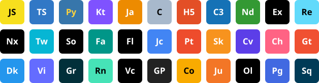
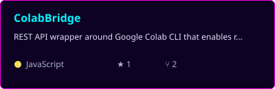
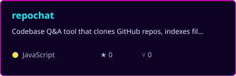
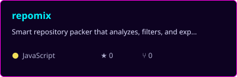
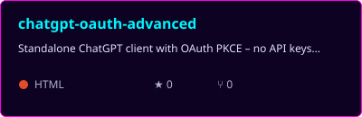
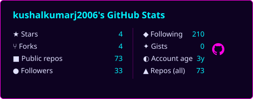
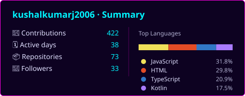
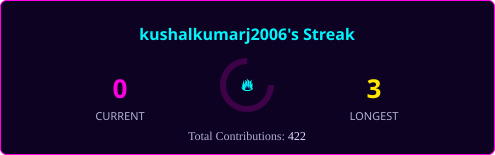
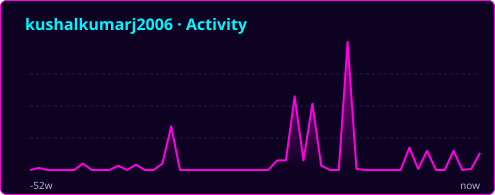

  

<h1 align="center">Hi 👋, I'm Kushal Kumar J</h1>

<i>Full Stack Developer | AI Tooling Builder | Android & Social-Impact Tech Enthusiast</i>

  

  

  

---

## 🧑‍💻 About Me

- 🚀 I love coding, and I ship fast: **71 public repos**, with most of my recent work around **AI tooling, developer productivity, and web apps**.
- 🤖 My current focus is **LLM-powered developer tools**: turning free Google Colab GPUs into a REST API, building codebase Q&A with RAG, and packing repos for AI prompts.
- 🌾 I build for **social impact**, with offline-first and voice-first apps for rural India (farmers, students, artisans) in **Kotlin, Jetpack Compose, React, and TypeScript**.
- 🔐 I'm also drawn to **security and ML**: password breach detection, a vulnerability scanner, a secure login system, explainable house-price prediction, and YOLOv8 crowd-safety analytics.
- 🥋 Outside code, I'm into Mixed Martial Arts.

---

## 🛠️ Tech Stack

  

---

## 🌟 Featured Projects

<table>
<tr>
<td width="42%" align="center" valign="middle">

  · 
</td>
<td valign="middle">
Turns Google Colab into a headless REST API so you can run Python on remote GPU VMs (Nvidia T4) over plain HTTP.  
⚙️ <b>Stack:</b> Node.js, Express, Python, Docker, Render 
✨ <b>Highlights:</b> Async code execution with status polling, FIFO session eviction, and automatic keep-alive pings to beat Colab's idle timeout.
</td>
</tr>
<tr>
<td width="42%" align="center" valign="middle">

 <a href="https://github.com/kushalkumarj2006/repochat"><b>📂 Repo</b></a> · <a href="https://kushalkumarj2006.github.io/repochat/"><b>🔗 Live Demo</b></a>
</td>
<td valign="middle">
Chat with any public GitHub repo with no local GPU. It clones, indexes, and answers questions using a RAG pipeline running on remote Colab.  
⚙️ <b>Stack:</b> Vanilla JS, ChromaDB, BGE-M3, Ollama (Qwen coder models), ColabBridge 
✨ <b>Highlights:</b> Answers with source-file citations, plus a ⚡ Fast (RAG) / 💬 Simple (direct LLM) dual mode.
</td>
</tr>
<tr>
<td width="42%" align="center" valign="middle">

 <a href="https://github.com/kushalkumarj2006/repomix"><b>📂 Repo</b></a> · <a href="https://kushalkumarj2006.github.io/repomix/"><b>🔗 Live Demo</b></a>
</td>
<td valign="middle">
A smart repository packer that exports clean, token-efficient codebases for AI assistants like Claude, ChatGPT, and Gemini.  
⚙️ <b>Stack:</b> JavaScript, Node.js, Express, adm-zip, JSZip, pako, 7z, Render, GitHub Pages 
✨ <b>Highlights:</b> Interactive ASCII file tree with granular selection, comment stripping for 18+ languages, 7z compression, and a multi-token GitHub rate-limit load balancer.
</td>
</tr>
<tr>
<td width="42%" align="center" valign="middle">

 <a href="https://github.com/kushalkumarj2006/chatgpt-oauth-advanced"><b>📂 Repo</b></a> · <a href="https://kushalkumarj2006.github.io/chatgpt-oauth-advanced/"><b>🔗 Live Demo</b></a>
</td>
<td valign="middle">
A standalone ChatGPT client that signs in with OAuth 2.0 PKCE, so no API keys are needed.  
⚙️ <b>Stack:</b> HTML5, Vanilla JS, Node.js, Express, marked.js, highlight.js, Render 
✨ <b>Highlights:</b> Streaming markdown over SSE, image/file attachments, web search and code interpreter toggles, and self-healing token refresh.
</td>
</tr>
<tr>
<td width="42%" align="center" valign="middle">

 <a href="https://github.com/kushalkumarj2006/password-strength-analyzer"><b>📂 Repo</b></a> · <a href="https://kushalkumarj2006.github.io/password-strength-analyzer"><b>🔗 Live Demo</b></a>
</td>
<td valign="middle">
A client-side password auditor with real breach detection against 100,000 leaked passwords.  
⚙️ <b>Stack:</b> JavaScript, Chart.js, Lodash, IndexedDB, Web Crypto API 
✨ <b>Highlights:</b> Instant breach lookup, entropy and GPU crack-time estimates, and generated stronger alternatives.
</td>
</tr>
</table>

### 📦 More Projects

| Project | Tech Stack | Description |
|---|---|---|
| [Mitti Ki Awaaz (Android)](https://github.com/kushalkumarj2006/MittiKiAwaaz) | Kotlin, Jetpack Compose, Room, CameraX | A voice-first Android climate-resilience app for farmers with a CameraX soil scanner and a Sarpanch dashboard. |
| [Mitti Ki Awaaz (Web PWA)](https://github.com/kushalkumarj2006/MittiKiAwaazWeb) · [Live](https://mittikiawaazweb.onrender.com) | JavaScript, PWA | A multilingual, voice-first PWA with AI crop advisory, weather alerts, and soil diagnostics. |
| [EduSync](https://github.com/kushalkumarj2006/EduSync) | Kotlin, Jetpack Compose, Room, Retrofit | An offline-first learning app for rural students with store-and-forward sync and a 50MB daily data budget. |
| [EstateIQ](https://github.com/kushalkumarj2006/EstateIQ) | Python, scikit-learn, SHAP, Flask, Chart.js | An explainable home valuation tool with confidence intervals, SHAP attributions, and comparable-sales retrieval. |
| [Crowd-Safety-Analyzer](https://github.com/kushalkumarj2006/Crowd-Safety-Analyzer) | Python, FastAPI, YOLOv8, OpenCV, React, TypeScript | An offline-first computer-vision platform that detects dangerous crowd surges from surveillance video. |
| [repomix-v2](https://github.com/kushalkumarj2006/repomix-v2) · [Live](https://repomix-v2-dyvk.onrender.com) | JavaScript, Node.js, Render | The v2 backend for the repo-packing platform, built to stream codebases to LLM context. |
| [deepseek-wrapper](https://github.com/kushalkumarj2006/deepseek-wrapper) · [Live](https://deepseek-wrapper.onrender.com) | Node.js, Express, WebAssembly | A self-hosted proxy and chat client with streaming output for DeepSeek's web interface. |
| [leetsync-ai](https://github.com/kushalkumarj2006/leetsync-ai) | Chrome Extension (MV3), FastAPI, yt-dlp, Docker | A Chrome extension that syncs LeetCode solutions to GitHub, with a FastAPI backend. |
| [KalaSetu](https://github.com/kushalkumarj2006/KalaSetu) · [Live](https://kala-setu.vercel.app) | JavaScript, Vite, Google Sheets API | A platform to digitize Indian folk art and help artisans with e-commerce and export readiness. |
| [vulnerability-scanner](https://github.com/kushalkumarj2006/vulnerability-scanner) | JavaScript | A zero-dependency, browser-native web vulnerability auditing tool. |
| [Secure-login](https://github.com/kushalkumarj2006/Secure-login) | Python | A single-file authentication reference implementation with layered defenses. |
| [tinystories-offline](https://github.com/kushalkumarj2006/tinystories-offline) | Transformers.js, HTML | Generates short stories fully offline with an LLM running in the browser. |
| [LOVE-HUB](https://github.com/kushalkumarj2006/LOVE-HUB) · [Live](https://love-hub.vercel.app) | HTML, JavaScript, Web Audio | An animated, interactive digital love letter with timeline and sound synthesis. |
| [free_AI](https://github.com/kushalkumarj2006/free_AI) · [Live](https://v0-free-ai-tools-kappa.vercel.app) | TypeScript, Vercel | A curated directory of 100+ free AI tools across six productivity domains. |
| [nextjs-blog-app](https://github.com/kushalkumarj2006/nextjs-blog-app) · [Live](https://nextjs-blog-app-seven.vercel.app) | Next.js, React | A clean, responsive blog starter with Markdown article pages. |

---

## 📊 GitHub Activity

  
   
  
   
  
   
  
   
  
    
  <picture>
    <source media="(prefers-color-scheme: dark)" srcset="https://raw.githubusercontent.com/kushalkumarj2006/kushalkumarj2006/output/github-snake-dark.svg" />
    <source media="(prefers-color-scheme: light)" srcset="https://raw.githubusercontent.com/kushalkumarj2006/kushalkumarj2006/output/github-snake.svg" />
    
  </picture>

---

## 🤝 Connect With Me

⭐ *If you like my work, drop a star on a repo!* ⭐

### 👑 I Am Legend

*Build. Break. Ship. Repeat.*

